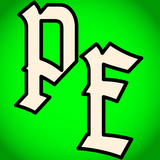

# Paintbooth

A fast, offline skin mod tool for **Euro Truck Simulator 2** and **American Truck
Simulator**. Its projects are **.pb** files, and it also opens, edits and saves **Mods Studio 2
projects (.ms2)**. It opens in its own window with a dark theme by default.

Paintbooth is an independent, clean-room program. It was written from SCS Software's
public modding documentation, open file-format documentation, and observation of
project files and the mods they produce. No Mods Studio code, templates, vehicle
data or artwork are included. It is not affiliated with SCS Software or Mods Studio.
The extra item types (lightbox, windscreen decal, door window, billboard, cargo container,
company logo, existing mod) are built from the template files of *your own* Mods Studio 2
installation, read at export time.

## Install (Windows, works offline)

Download **Paintbooth Setup 0.11.0.exe** from [Releases](https://github.com/AL3X-7777/paintbooth/releases)
and run it. It needs no admin rights and no internet, and it includes everything Paintbooth needs,
Python too. You can choose the install folder (default `%LOCALAPPDATA%\Programs\Paintbooth`;
updates go to the same folder) and tick *Create a desktop icon*. A Start-menu entry is always
added; to pin Paintbooth to Start or the taskbar, right-click it there. `.pb` project files open in Paintbooth, and Paintbooth
is added to "Open with" for `.ms2` files without taking them away from Mods Studio 2. To install a new version, run its Setup.exe:
it replaces the program files and keeps your projects and settings. Uninstall from
*Settings > Apps*.

The installer is not code-signed, so Windows SmartScreen may warn you. Choose
*More info > Run anyway*.

Paintbooth used to be called Paint booth, and before that Skinyard. Installing it over either one
removes the old program and moves `Documents\Paint booth` (or `Documents\Skinyard`) to
`Documents\Paintbooth`, with the same folders inside. Your settings and recent projects come along.

No installer? Unzip **Paintbooth 0.11.0 portable.zip** anywhere and run `Paintbooth.exe`.

### Your Paintbooth folder

`Documents\Paintbooth` is created on first start:

| Folder | Contents |
|---|---|
| Projects | default place for project files (`.pb`) |
| Vehicles | vehicle library XML files (edit them any time) |
| Exports\ATS, Exports\ETS2 | where F5 saves mods unless Settings says otherwise |
| Templates\ETS2, Templates\ATS | imported paint job template packs |
| Generated | colour swatches made outside a project |
| Defaults | the default icons |
| paintbooth.log | error log |

## The window

Paintbooth opens on a **start screen**: start a new ETS2 or ATS project, open one, or pick from
your recent projects (most recently opened first; right-click to remove one). **File** opens a
side bar with everything else (save, export, settings, recent projects, back to the start
screen).

The layout follows Mods Studio 2: **File / Home** ribbon (the former SCS Tools are on Home, between Export and Program), the project's
items on the left (Mod manifest first), and the selected item's tabs on the right.
Use the small buttons above the list to move an item to the top, up, down or bottom,
duplicate it, or delete it.

**Mod manifest:** Basic (name, author, version, DLC dependencies, categories,
compatible versions), Icon, Text, Multiplayer, Environment.

**Advanced Skin** (trucks and trailers; Mods Studio 2 calls it Advanced Truck Skin):

| Tab | Contents |
|---|---|
| Vehicle | Trucks and trailers grouped by brand, with a filter. Shows who wrote the vehicle definition. |
| Main | Basic, Icon, Metallic Options and Mask Options as collapsible sections on one page, with **Collapse all / Expand all**. Disabled options grey out until their "Enable" box is ticked. |
| Skins | One block per image: path, preview, and the cabins (or trailer bodies) it is *suitable for*. **Add image** adds an empty block; type or paste a path, or click Browse. |
| Accessories | Before the first accessory image, lists all of the vehicle's paintable accessories: tick some, then *Add image for the ticked accessories* or *Generate color*. After that, each image has its own list. **Generate color** makes a 64×64 DDS of any colour (hex, RGB or SCS linear values) with an opacity slider or typed value. |

In the Skins and Accessories lists, each entry shows its internal name after the display name,
and the search box can match the name, the internal name, or both. Right-click a list for
**Select all / none / invert**, which act only on the entries the search shows, and the
same three for the group under the mouse.

**Mod manifest:** one page with collapsible sections and Collapse all / Expand all. New
projects and new skins start with empty text fields (price, unlock level and colours keep their
defaults; the author is filled in only if you set a default creator name in Settings).

**Icons:** the shop icon and the Mod Manager icon use the **default icon** (a black tile
reading "paintbooth by AL3X" in the Forgore font) unless you choose otherwise: **Browse** for an image,
or **Use skin image**. **Use default icon** goes back to it. Forgore isn't bundled, so install it in
Windows or choose the font file in Settings; until then a bold system font is used.

**Can't see the item list?** Press **Ctrl+M** or the ribbon's *Mod manifest* button. The list
also can't be dragged narrower than 180 px any more.

## Settings (Home > Settings)

* Default export folders for ATS and ETS2, and the games' mod folders
* The "exported successfully" message after each export (on by default; any key or click closes it,
  clicking the folder opens it)
* Check GitHub for a new version at start (only when online; it just tells you, nothing is downloaded)
* Folder the image Browse buttons open in
* Default creator name, with an option to add " by <creator>" to the mod name on export
* **Add the version number to the end of the mod name** on export: "My skins by AL3X V1.02". The
  manifest editor shows the exported name under the Mod Name field.
* Automatic version numbers: 1.00, 1.01, 1.02… per project. This replaces the Mod Version field.
* **Default mod description**: new projects start with it, and you can change it per project (what
  you type replaces the default). A project with an empty description exports with the default.
  *Use default description* in the manifest puts it back.
* **Mods Studio 2 folder**, for the extra item types (found automatically, e.g. `C:\Mods Studio 2`)
* Default-icon font and dark mode
* **Text size** (points) and **UI scale** (80-200 %, on top of Windows' display scaling). The ribbon
  wraps onto a second row when it doesn't fit.

## Tutorials

**File > Tutorials** (or **F1**) explains Paintbooth and paint job modding: quick start, a first
truck skin step by step, templates, image sizes and formats, accessories, paint job
options, trailers, vehicle XML files, the mod manifest, exporting and testing in game,
troubleshooting, colours, shortcuts, folders and a glossary. Everything is searchable.

## Templates

Download the template pack for your game (needs internet once):
[ETS2 truck & trailer templates](https://forum.scssoft.com/viewtopic.php?t=288778) ·
[ATS truck & trailer templates](https://forum.scssoft.com/viewtopic.php?t=272386)
(SCS forum; e.g. *ETS2_templates (game ver. 1.59).zip*). Then
**Settings > Templates > Import template pack**. It is unpacked into
`Documents\Paintbooth\Templates\ETS2` (or `ATS`).

On the **Skins** tab, the *Templates* bar shows the folder for the chosen vehicle; **Open folder**
opens it. Folders are matched by the vehicle's names (internal name, in-game name, the XML's
name). If the match is wrong or missing, **Choose folder…** once and it is remembered.

## Colours

Every colour button opens the same picker: a colour square and hue bar, hex, RGB and SCS
(linear) values, and **palettes** (basic, fleet colours, a RAL selection, material, greys).
**New palette…** makes your own palette: pick a colour and click *+ Add current colour*;
right-click a colour in it to rename or remove it. **Save current** keeps a colour in *Saved colours*. Saved and recent colours are shared by all
projects. Right-click a saved colour to remove it. Tool windows reopen where you last put them,
and on Windows 10/11 they use a dark title bar.

Each field gets a green tick, a warning or an error mark (hover for details). The status
bar counts problems, and clicking it lists them all. Items with errors turn red in the list.

Shortcuts: **Ctrl+Shift+S** save as · **F5** export (to the default export folder, no dialog) · **Ctrl+M** mod manifest · **Shift+F5** export straight into the game's mod folder ·
**Ctrl+S** save · **Ctrl+O** open · **Ctrl+N** new · **Ctrl+D** duplicate · **Del** delete.

## Projects: .pb and .ms2

* Paintbooth projects are `.pb` files. Inside, a `.pb` is exactly a Mods Studio 2 project: rename
  it to `.ms2` and Mods Studio 2 opens it (and the other way round).
* New projects are saved to `Documents\Paintbooth\Projects` automatically as `.pb`, named after the mod.
  **Save as** (Ctrl+Shift+S) suggests a `.pb` file; pick *Mods Studio 2 project* in the type list
  to save an `.ms2`. **Save** (Ctrl+S) keeps the file's own type.
* Open any `.pb` or `.ms2` file. Saving an unchanged project produces a byte-identical file,
  and edits change only the values you touched. Mods Studio 2 can keep editing the same file.
* Item types Paintbooth doesn't support yet stay in the file untouched and are skipped on export.
* New items are copied from an existing Advanced Truck Skin in the project, or in a project
  you opened before, so they keep Mods Studio 2's structure. Only if there is none does
  Paintbooth create its own minimal version. Paintbooth can export those, but Mods Studio 2 may
  not build them.
* Images are found even if the project has moved to another folder or PC, as long as the
  image files sit somewhere in the project's folder.

## Vehicles - editable XML, live

Every MS2 project stores the full definition of the trucks it uses, so those appear in the
Vehicle list straight away ("stored in this project"). Your **vehicle library** is the folder
`Documents\Paintbooth\Vehicles`. Put vehicle XML files there in either format:

* **Mods Studio 2's own vehicle files** (`<Variable xsi:type="ScsVehicleVariable">`), as shared
  by the community, for trucks and trailers. Drop them in unchanged.
* Paintbooth's shorter format (below).

**Import folder…** in the Vehicles window copies a folder of XML files (and its `Images` folder)
into the library. When several files use the same internal name (ATS and ETS2 versions, or two
authors' definitions of one trailer) each one is listed separately with its file name, and
entries without paintable accessories are marked. Vehicles marked "All" in MS2 files show up in
both ATS and ETS2 projects.

Changes are picked up within a second, even while a project is open.

* **Home > Vehicles** lists the library (with a search box) and has an XML editor:
  find and replace (Ctrl+F / Ctrl+H), go to line (Ctrl+G), live error checking while you type,
  auto-indent, Tab / Shift+Tab, Ctrl+/ comment, Ctrl+D duplicate line, Ctrl+plus/minus text size.
  **Add accessory…** asks for name, internal name and group (type to search the existing groups,
  or type a new one) and inserts the entry next to the rest of its group. **Add cabin / body…** does the
  same for cabins or trailer bodies. Files are saved back in their original encoding.
* **Vehicle tab > Save to library** copies a vehicle out of a project into an XML file.
* **Scan game…** reads the game's own `def.scs` and `dlc_*.scs` directly. Point it at the
  game folder, and it builds library entries with every cabin and every accessory SCS's own
  paint jobs recolour. It also reads mod trucks (`.scs`/`.zip`) and extracted folders.
  Existing library files are never overwritten.

Library XML format:

```xml
<vehicle id="freightliner.cascadia2019" game="ats" brand="Freightliner" name="Cascadia 2019"
         author="SCS Software" definition_by="you">
  <variant id="day.freightliner.cascadia2019.cabin" name="Day Cab"/>          <!-- suitable_for -->
  <accessory value="bumper.aero_pt" group="Bumper" name="Aero Paint"/>         <!-- acc_list -->
</vehicle>
```

## More item types (Home > Add more)

Besides Advanced Skins, a project can hold the items below. They work like Mods Studio 2's,
because they are built from Mods Studio 2's own template files: models, materials and the PNG
templates you paint on. So **Mods Studio 2 must be installed on the same PC** (Paintbooth finds
it in `C:\Mods Studio 2` and the usual places, or set the folder in Settings). Your MS2 projects
with these items open as editable items too.

| Item | Game | What it makes |
|---|---|---|
| Truck lightbox | ETS2 | your artwork in the Volvo FH3-FH6 roof lightbox, sold in the truck shop |
| Truck windscreen decal | ETS2, ATS | a windscreen decal per truck, slot pattern and windscreen type |
| Truck door window | ETS2 | artwork on the Scania R/S 2016 door windows |
| Billboard | ETS2, ATS | replaces the roadside billboards of one billboard model (one billboard mod at a time) |
| Cargo container V2 | ETS2, ATS | a cargo with your own 20/40 ft (and ATS 53 ft) container skins, companies, value… |
| Player company logo | ETS2, ATS | replaces the logos you can choose for your company |
| Existing mod | ETS2, ATS | packs another mod's files (.scs or .zip) into this mod |

The form shows the same fields Mods Studio 2 does, grouped the same way; fields that don't apply
to your choice (e.g. slot patterns for a truck without them) are hidden. **Open template folder**
opens MS2's folder for the item, with the PNG templates. Empty shop icons use the template's
default icon. Cargo containers start each cargo from one of the game's cargos (weight, value,
companies…), with a new internal name of your own.

How it's built: Paintbooth runs the template's build steps itself (copy files, write and patch
text, import images, write .tobj files, rename the models' materials). Materials are named by the
CityHash64 of their text, like the game does. A lightbox built by Paintbooth was compared with a
real Mods Studio 2 export: all 30 files were byte-identical.

## Export

The export writes the same files Mods Studio 2 does for Advanced Truck Skins: one paint job
per cab image (`<name>_<n>`) with its `suitable_for[]` cabins, an accessory override file for
each, the shop icon, and the manifest. The paint-job settings are written inline in each `.sii`
rather than in separate `.sui` include files, which the game treats the same.
Tested against a real Mods Studio 2 export: cabin lists, accessory lists, unit names,
texture paths and every `.tobj` byte matched.

**Trailers** use the owned-trailer layout (`def/vehicle/trailer_owned/<trailer>/paint_job/…`):
one paint job per skin, and each skin image is applied to the bodies it is suitable for through
accessory overrides. This follows the game's documented structure, but it has not been compared
with a Mods Studio 2 trailer export, so check your first trailer skin in game.

Textures are compressed with Paintbooth's own DXT5/DXT1 encoder. Alpha is fitted per 4×4 block, so
anti-aliased, partly transparent edges stay smooth. Fully transparent pixels take the colour of nearby
paint, so edges don't fringe when the game filters the texture, and mipmaps are averaged with alpha
weighting.

It is fast because:

* Textures are converted on all CPU cores at once.
* Converted and compressed textures are cached (`~/.paintbooth/cache`), so an
  export after editing text settings only rewrites the small files.
* DDS images are used as-is.
* The archive is written by a parallel ZIP writer.

## Command line

```
paintbooth                      open the window
paintbooth export project.pb    export without the window (-o file.scs); .ms2 works too
```

## Not done yet

The Mask "Color Variants" option, SCS Extractor, 3D Preview, UV Exporter, Model Explorer, and
Mods Studio 2 item types other than the ones above (simple truck skin, mudflaps, traffic and AI
skins, standalone trailers, engines, simple cargo). Those stay in the project untouched. Exported mods are built to match
a verified Mods Studio 2 export, but check your first one in game.

## Development and releases

Source and releases: <https://github.com/AL3X-7777/paintbooth>. Every push is built and tested on
GitHub (Actions); pushing a tag such as `v0.11.0` publishes a release. See [RELEASING.md](RELEASING.md).
Changes per version: [CHANGELOG.md](CHANGELOG.md). Code signing and privacy: [CODE_SIGNING.md](CODE_SIGNING.md).

